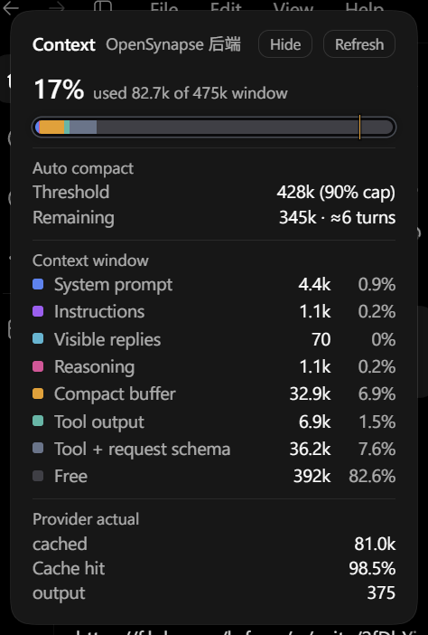
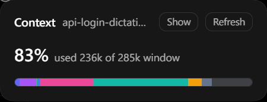

# CodexDictationUnlock

中文 | [English](#english)

## 中文

为 Windows 版 Codex Desktop 的 API Key 登录解锁原生 Dictation，并把音频转发到兼容的实时 ASR 服务。

### 当前版本

首个公开版本：`v1.0.0`；当前版本：`v1.2.7`

`v1.2.0` 加入上下文窗口面板和 `/context` 接口；`v1.2.1` 让面板标题跟随会话切换、进度条随轮询重绘，并接入 Voice 设置里的面板开关；`v1.2.2` 增加自动压缩阈值、剩余轮数估算和 Provider 缓存命中率；`v1.2.3` 移除实验性的占用 Top 3 区块；`v1.2.4` 把 bundle 正则替换移到一次性子进程，并切到工作站 GC，消除空闲时数百 MB 的 ArrayPool 缓冲和 Server GC 预留；`v1.2.5` 适配 Codex `26.1016.8622.0` 的能力门，固定解锁 Dictation，避免 API Key 登录时被新版权限检查隐藏；`v1.2.6` 补齐输入框实际使用的 `dictation.chatgpt` 门和 `requiresFirstPartyInference` 父门，修复自定义 provider 下麦克风不显示；`v1.2.7` 适配 Codex `26.1021.3705.0`，补丁失败时不再循环重载页面，并继续所有被暂停的 bundle 请求。

已在 ChatGPT Desktop（Codex）客户端 `26.1016.8120.0`（Microsoft Store 包 `OpenAI.Codex_26.1016.8120.0_x64__2p2nqsd0c76g0`）验证注入链路、听写传输和上下文面板。启动时会等待 CDP 调试端点真正可用；失败的启动实例会在重试前清理。注入补丁会先等客户端首屏加载完成再触发 `Page.reload`，避免打断客户端自身那次 `loadURL` 而弹出 “ChatGPT failed to start.”。客户端更新后，注入点可能需要重新验证。会话标题生成默认关闭；需要时可在 Voice 设置中选择自定义接口或当前对话模型接管。

### 支持的 ASR 服务

| 服务商 | 模型 | 设置页需要填写 |
| --- | --- | --- |
| 阿里云 DashScope | `qwen3-asr-flash-realtime` | Workspace ID、API Key |
| 火山引擎 | 豆包大模型双向流式 | Resource ID、API Key |

火山引擎使用官方双向流式接口 `wss://openspeech.bytedance.com/api/v3/sauc/bigmodel_async`。默认 Resource ID 是 `volc.seedasr.sauc.duration`，也可以在 Voice 设置中填写账号实际分配的 Resource ID。

### 功能

- 使用 Codex 原生 Voice 设置和听写输入框，不提供额外的前台窗口。
- 兼容主对话输入框与 Annotation 评论输入框，听写结果写入当前焦点编辑器。
- 实时发送 16 kHz、16-bit、单声道 PCM 音频。
- 转发实时增量识别结果和分句最终结果。
- 将 Codex Voice 页面中的听写词典作为 ASR 热词上下文提交。
- API Key 使用 Windows Credential Manager 保存，不写入 `config.json`。
- 设置卡片跟随 Codex 当前语言显示中文或英文。
- 在 Voice 设置中显示当前生效的 `model_provider`，允许自定义 Provider 修改模型响应流重连次数；内置 `openai`、`ollama`、`lmstudio` 保持 Codex 默认值 5。
- 可在 Voice 设置中用自定义接口或当前对话模型接管新会话标题生成，绕开中转 API 对 `gpt-5.6-luna` 的屏蔽。
- 在 Codex 右栏原生摘要面板旁显示完整上下文窗口：大字百分比来自 provider 的 `token_count`，进度条按整个窗口划分已用内容、压缩后保留历史和剩余空间。只读 `~/.codex/sessions`，不引入 SQLite 或 NuGet 依赖。

### 使用发布版

1. 从 [Releases](https://github.com/A1mAssist/CodexDictationUnlock/releases) 下载 `CodexDictation.exe`。
2. 如果 Codex 已在运行，启动时 Helper 会弹窗询问是否关闭并重新注入；无需提前手动结束。
3. 双击 `CodexDictation.exe`。Helper 会启动带调试端口的 Codex，并自动注入补丁。
4. 打开 Codex 的 `Settings > Voice`，找到 `Dictation ASR` 配置卡片。
5. 选择服务商：
   - 阿里云：填写 Workspace ID 和 DashScope API Key。
   - 火山引擎：填写 Resource ID 和火山引擎 App Key。
6. 保存配置，并在 Voice 设置中设置 Dictation hotkey。
7. 使用 Codex 原生听写入口开始录音。
8. 如需调整模型响应流重连次数，在同一 Voice 页面修改“模型响应流重连”；对新对话生效；现有对话需重启 Codex。
9. 需要接管新会话标题时，在同一页面底部的“会话标题生成”卡片中选择“自定义接口”或“当前对话模型”并保存。

Helper 没有独立的前台 UI。运行日志位于 `%APPDATA%\CodexDictation\helper.log`。
当 Codex 退出后，Helper 会自动停止；下次可以直接再次双击 exe 启动。
如果启动时检测到已有 ChatGPT 进程，会先询问是否关闭并重新启动注入；选择“否”不会修改现有客户端。
注入不会在 Codex 已完成加载后强制刷新页面；能在首次加载阶段拦截时直接完成补丁。

### 配置和凭据

配置文件：`%APPDATA%\CodexDictation\config.json`

- 阿里云 API Key：Windows Credential Manager 目标 `CodexDictation.Aliyun.ApiKey`
- 火山引擎 API Key：Windows Credential Manager 目标 `CodexDictation.Volcengine.ApiKey`
- 标题生成 API Key（可选）：Windows Credential Manager 目标 `CodexDictation.Title.ApiKey`

API Key 只在本机 Helper 与对应 ASR 服务建立连接时使用，不会通过 Codex 页面发送。

### 会话标题生成

Codex 用固定的小模型 `gpt-5.6-luna` 生成新会话标题，部分中转 API 会禁用该模型，标题因此停留在临时标题。Voice 设置底部的“会话标题生成”卡片提供两种接管方式：

- `自定义接口`：标题请求只发往填写的接口地址与模型，支持 `chat`（Chat Completions）和 `responses` 两种协议。接口拒绝结构化输出或思考强度参数时，去掉这两个参数重试一次。API Key 可选，留空时不带 `Authorization` 头。
- `当前对话模型`：使用当前对话的模型，从 `%USERPROFILE%\.codex\config.toml` 读取当前 Provider 的 `base_url` 与凭据，以最低思考强度发起请求。只对配置了 `base_url` 的自定义 Provider 生效；内置 `openai`、ChatGPT 登录或 `ollama`/`lmstudio` 会自动保留 Codex 原生行为。

标题生成失败不会回退到 `gpt-5.6-luna`，会话保留临时标题，错误写入 `helper.log`。选择 `关闭` 完全保留 Codex 原生行为。

### 上下文面板



Helper 启动后会在 Codex 右栏原生摘要面板旁挂上 Context 面板，不需要额外启动进程。

- 大字百分比来自 provider 上报的 `event_msg/token_count`，与 Codex 原生 “Context usage” 环一致。
- 进度条表示整个 context window：彩色段按转录体积分摊已用部分，橙色 “Compacted history” 是最后一次压缩的 `replacement_history`，深灰 “Free” 是窗口里尚未使用的空间。所有段百分比都以窗口总量为分母；图片按像素计价。
- “Instructions” 是 developer 角色的注入指令：app context、skills 指令、每轮 user steer、模型切换、Ponytail、协作模式和时间上下文。
- “Tool + request schema” 是 provider 总量减去已解析内容后的差额。它包含工具 schema 和请求脚手架；rollout 不保存两者的拆分，所以面板合并显示。分页会话的旧页内容由最近一次压缩后保留历史覆盖。
- “自动压缩” 显示 Codex 的有效自动压缩阈值：配置值低于窗口的 90% 时用配置值，否则用 90% 上限。进度条上的竖线标出阈值，剩余 token 和轮数按最近 5 个已完成回合的增量估算；“回合结束” 单独显示 `model_post_turn_compact_threshold_percent`。
- “缓存命中” 是最近一次 provider 统计里的 `cached_input_tokens / input_tokens`，用于判断中转 API 的实际缓存收益。
- 分页会话读取最新一页 rollout，不会拿父页的旧上下文来显示。
- 面板每 5 秒刷新一次；切换会话后标题在 1 秒内跟随侧栏更新；Codex 重载后由同一注入脚本重新挂载。新建的空对话不显示面板，发送第一条消息后自动出现。右上角的“收起”按钮只隐藏下方明细，标题栏、大字百分比和完整窗口条仍然保留；选择会被记住。
- `Settings > Voice` 底部的“上下文面板”开关控制是否挂载，默认开启；关闭后 `/context` 返回 404，面板立即消失，所有对话共用这个设置。
- 数据来自 `%USERPROFILE%\.codex\sessions` 下的 rollout JSONL，只返回 token 数字；侧栏标题缺失时用工作目录名兜底，不返回消息正文或完整路径。

收起后只保留标题栏、大字百分比和完整窗口条：



构成比例是估算，总百分比才准确；Codex 修改右栏 DOM 后锚点可能失效，`helper.log` 会记录 `Context panel did not mount`。

### 常见问题

**配置卡片显示 Helper unavailable**

确认 Helper 正在运行，并且没有被防火墙拦截 `127.0.0.1`。查看 `%APPDATA%\CodexDictation\helper.log` 获取具体错误。

**火山引擎连接失败**

确认使用的是火山引擎 App Key，并且 Resource ID 与账号开通的服务一致。ASR 1.0 和 ASR 2.0 的 Resource ID 不能混用。

**听写按钮仍不可用**

在 `Settings > Voice` 中先设置一个 Dictation hotkey。Codex 原生逻辑要求存在 hotkey 后才启用保持听写栏显示等相关功能。

### 从源码构建

需要 Windows 11 和 .NET 8 SDK：

```powershell
dotnet build -c Release
dotnet run -c Release --no-build -- --self-test
dotnet publish -c Release -r win-x64 --self-contained false -p:PublishSingleFile=true -o .\artifacts\publish-framework
```

只支持 Windows x64。构建产物是依赖系统 .NET 8 Runtime 的单文件 exe。

## English

Unlocks native Dictation for API-key sessions in Codex Desktop for Windows and forwards audio to compatible real-time ASR providers.

### Current release

First public release: `v1.0.0`; current release: `v1.2.7`

`v1.2.0` added the context-window panel and its `/context` endpoint. `v1.2.1` makes the panel title follow thread switches within one second, keeps the meter redrawing on the five-second poll, and gates `/context` behind the `Context panel` Voice switch. `v1.2.2` adds the effective auto-compaction threshold with remaining-turn estimates and provider cache-hit rate. `v1.2.3` removes the experimental Top 3 consumers block. `v1.2.4` moves bundle regex replacement into a one-shot child process and uses workstation GC, removing hundreds of MB of idle ArrayPool buffers and Server GC reservations. `v1.2.5` adapts to the capability gate in Codex `26.1016.8622.0`, keeping Dictation unlocked for API-key sessions. `v1.2.6` also unlocks the `dictation.chatgpt` gate used by the composer and disables the `requiresFirstPartyInference` parent gate for Dictation, restoring the microphone with a custom provider. `v1.2.7` adapts to Codex `26.1021.3705.0`, stops reload loops when a bundle patch cannot be applied, and continues every paused bundle request.

Injection, dictation transport, and the context panel were validated against ChatGPT Desktop (Codex) client version `26.1016.8120.0` (Microsoft Store package `OpenAI.Codex_26.1016.8120.0_x64__2p2nqsd0c76g0`). Startup waits for the CDP endpoint and cleans up a failed launch instance before retrying. The bundle patch now waits for the client's first page load to complete before issuing `Page.reload`, so it no longer aborts the client's own `loadURL` and triggers the "ChatGPT failed to start." dialog. Injection points may need to be revalidated after a client update. Thread-title routing is off by default; choose a custom endpoint or the current conversation model in Voice settings to take over.

### Supported ASR providers

| Provider | Model | Settings required |
| --- | --- | --- |
| Aliyun DashScope | `qwen3-asr-flash-realtime` | Workspace ID and API key |
| Volcengine | Doubao BigModel bidirectional streaming | Resource ID and API key |

Volcengine uses the official bidirectional streaming endpoint `wss://openspeech.bytedance.com/api/v3/sauc/bigmodel_async`. The default Resource ID is `volc.seedasr.sauc.duration`; replace it with the Resource ID provisioned for your account when necessary.

### Features

- Uses Codex's native Voice settings and dictation composer; there is no separate foreground UI.
- Supports both the main conversation composer and Annotation comment editors, using the focused editor.
- Streams 16 kHz, 16-bit, mono PCM audio.
- Relays interim transcript deltas and final utterance results.
- Sends the dictation dictionary from Codex Voice settings as ASR hotword context.
- Stores API keys in Windows Credential Manager instead of `config.json`.
- Follows Codex's current language for the injected settings card.
- Shows the active `model_provider` in Voice settings and lets custom providers change model-response stream retries; built-in `openai`, `ollama`, and `lmstudio` keep Codex's default of 5.
- Can route new-conversation title generation to a custom endpoint or the current conversation model, bypassing relays that block `gpt-5.6-luna`.
- Shows the full context window next to Codex's native summary panel: the headline percentage comes from the provider's `token_count`, and the meter splits the whole window into used content, compacted history, and free space. It reads only `~/.codex/sessions` and adds no SQLite or NuGet dependency.

### Use the release build

1. Download `CodexDictation.exe` from [Releases](https://github.com/A1mAssist/CodexDictationUnlock/releases).
2. If Codex is already running, the Helper asks whether to close and restart it for injection; you do not need to close it manually first.
3. Double-click `CodexDictation.exe`. The Helper starts Codex with a debug port and injects the patch.
4. Open `Settings > Voice` and find the `Dictation ASR` card.
5. Choose a provider:
   - Aliyun: enter the Workspace ID and DashScope API key.
   - Volcengine: enter the Resource ID and Volcengine App Key.
6. Save the settings and configure a Dictation hotkey in Voice settings.
7. Use Codex's native dictation entry point.
8. To adjust model-response stream retries, use the new Voice setting; changes apply to new conversations; restart Codex for existing ones.
9. To take over new-conversation titles, use the `Thread title generation` card at the bottom of the same page: pick `Custom endpoint` or `Current conversation model`, then save.

The Helper has no separate foreground UI. Logs are written to `%APPDATA%\CodexDictation\helper.log`.
When Codex exits, the Helper stops automatically, so the executable can be launched again for the next session.
If ChatGPT is already running at startup, the Helper asks whether to close and restart it for injection; choosing No leaves the existing client unchanged.
The Helper does not force a page reload after Codex has loaded; it patches the initial load when interception is available.

### Configuration and credentials

Configuration file: `%APPDATA%\CodexDictation\config.json`

- Aliyun API key: Windows Credential Manager target `CodexDictation.Aliyun.ApiKey`
- Volcengine API key: Windows Credential Manager target `CodexDictation.Volcengine.ApiKey`
- Title generation API key (optional): Windows Credential Manager target `CodexDictation.Title.ApiKey`

API keys are used locally by the Helper to connect to the selected ASR service and are not sent through the Codex page.

### Thread title generation

Codex generates new-conversation titles with the fixed small model `gpt-5.6-luna`; some relay providers block it, leaving threads on their provisional title. The `Thread title generation` card at the bottom of Voice settings takes over in two ways:

- `Custom endpoint`: title requests go only to the configured endpoint and model, over either `chat` (Chat Completions) or `responses`. When the provider rejects the structured-output or reasoning-effort parameters, one stripped retry is made. The API key is optional; when it is empty no `Authorization` header is sent.
- `Current conversation model`: uses the current conversation model with the endpoint and credentials read from the active provider in `%USERPROFILE%\.codex\config.toml`, at the lowest reasoning effort. Only custom providers with a `base_url` qualify; built-in `openai`, ChatGPT sign-in, `ollama`, and `lmstudio` keep Codex's native behavior.

Title generation never falls back to `gpt-5.6-luna`: on failure the thread keeps its provisional title and the error is written to `helper.log`. `Off` keeps Codex's native behavior.

### Context panel


Once the Helper starts, a Context panel appears next to Codex's native summary panel. No separate process is needed.

- The headline percentage comes from the provider's `event_msg/token_count`, matching Codex's native "Context usage" ring.
- The meter represents the whole context window: colored bands split the transcript's used portion, the orange "Compacted history" is the last compaction's `replacement_history`, and the dark "Free" band is the unused remainder. Every percentage uses the window total as its denominator; images are priced by pixels.
- "Instructions" covers developer-role messages: app context, skills instructions, per-turn user steer, model switch, Ponytail, collaboration mode, and time context.
- "Tool + request schema" is the provider total minus the parsed rollout content. It contains tool schemas and request scaffolding; the rollout does not preserve their split, so the panel shows them together. Prior pages in a paginated thread are covered by the latest compacted history.
- "Auto compact" shows Codex's effective automatic-compaction threshold: a configured limit below the window's 90% cap wins; otherwise the 90% cap applies. The meter's vertical marker shows it, remaining tokens and turns use the latest five completed-turn deltas, and "End-of-turn" shows `model_post_turn_compact_threshold_percent` separately.
- "Cache hit" is `cached_input_tokens / input_tokens` from the latest provider usage, useful for judging relay-API cache savings.
- Paginated threads read the newest rollout page, not the parent page.
- The panel refreshes every five seconds; after a thread switch its title follows the sidebar within one second. It remounts after a Codex reload through the same injected script. It stays hidden in a new empty conversation and appears after the first message. The Hide button only hides the details; the header, headline percentage, and full-window meter stay visible, and the choice is remembered.
- The `Context panel` switch at the bottom of `Settings > Voice` controls whether the panel mounts. It is on by default; turning it off makes `/context` return 404 and the panel disappears immediately. The setting is shared by every conversation.
- Data comes from rollout JSONL files under `%USERPROFILE%\.codex\sessions`; the endpoint returns token counts only and falls back to the working-directory name when the sidebar title is unavailable, never message text or a full path.

Collapsed keeps the header, headline percentage, and full-window meter:


The band split is an estimate; the total percentage is exact. If Codex renames the right-rail DOM, the anchor can fail and `helper.log` records `Context panel did not mount`.

### Troubleshooting

**The card says Helper unavailable**

Make sure the Helper is running and that the firewall allows its `127.0.0.1` listener. Check `%APPDATA%\CodexDictation\helper.log` for the exact error.

**Volcengine connection fails**

Use a Volcengine App Key and a Resource ID provisioned for the same account. ASR 1.0 and ASR 2.0 Resource IDs are not interchangeable.

**Dictation is still disabled**

Configure a Dictation hotkey in `Settings > Voice` first. Codex's native logic requires a hotkey for related dictation controls.

### Build from source

Windows 11 and the .NET 8 SDK are required:

```powershell
dotnet build -c Release
dotnet run -c Release --no-build -- --self-test
dotnet publish -c Release -r win-x64 --self-contained false -p:PublishSingleFile=true -o .\artifacts\publish-framework
```

Windows x64 is currently supported. The published single-file executable requires the system .NET 8 Runtime.
